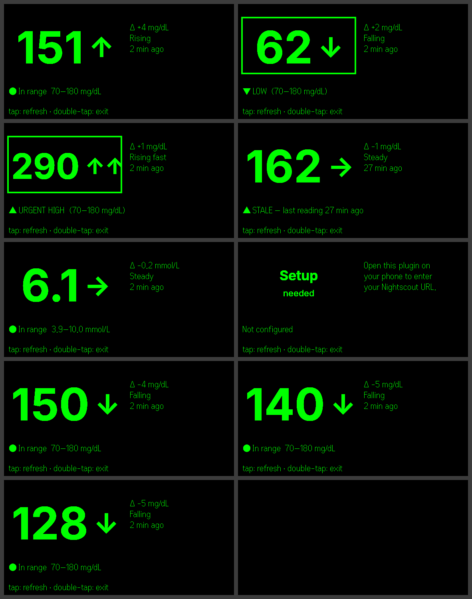

# Glucose HUD for Even G2

Glanceable CGM glucose on Even Realities G2 glasses: big number, trend arrow,
delta, reading age, and range alerts — pulled from your own
[Nightscout](https://nightscout.github.io/) site.



**Not a medical device.** This shows data from your Nightscout for convenience.
Confirm with your meter or CGM app before treatment decisions.

## How it works

```
G2 glasses  ⇄  Even App (phone, runs this web plugin)  →  relay (Cloudflare Worker)  →  your Nightscout
```

- `src/nightscout.ts` — fetch + parse `/api/v1/entries.json`, trend arrows, delta, mg/dL ↔ mmol/L, staleness
- `src/render.ts` — draws the big number on a canvas → PNG → G2 image container (the firmware font has no size control)
- `src/hud.ts` — 576×288 layout: image tile + three text containers; in-place updates, full rebuild on foreground re-entry
- `src/phone-ui.ts` + `index.html` — settings form on the phone (URL, token, relay, units, thresholds, poll rate) with live preview
- `relay/worker.js` — stateless relay. Even Hub only allows pre-whitelisted origins (no wildcards), and every user has a different Nightscout host, so the plugin calls one fixed origin which forwards the request. Stores nothing, strips the response to `sgv/direction/date/delta`, blocks non-HTTPS / private hosts.
- `mock/nightscout.mjs` — fake Nightscout with scenarios for local testing

## Develop

```bash
npm install
npm run mock          # fake Nightscout on http://localhost:1337 (also /low /uhigh /stale /flat)
npm run dev           # vite on :5173
npm run simulate      # Even Hub simulator pointed at the dev server
```

Open the simulator at `http://localhost:5173/?ns=http://localhost:1337` to skip the
settings form (dev-only query overrides: `ns`, `token`, `relay`, `units=mmol`, `poll`).

Headless screenshots of every state (needs Xvfb):

```bash
bash scripts/sim-shots.sh    # writes shots/*.png
```

Tests: `npm test` (14 unit tests: parsing, thresholds, units, URLs, relay SSRF guard).

## Ship

1. **Deploy the relay** (free Cloudflare account):
   ```bash
   cd relay && npx wrangler deploy
   ```
   Note the URL, e.g. `https://glucose-relay.<you>.workers.dev`.
2. Put that origin in `app.json` → `permissions[0].whitelist` (replace `REPLACE-ME`).
3. Build and pack:
   ```bash
   npm run build
   npx evenhub pack app.json dist -o glucose-hud.ehpk --sdk-ver 0.0.10
   ```
4. Test on hardware: `npx evenhub qr --url http://<your-lan-ip>:5173` and scan from the
   Even App's Developer Center; or upload the `.ehpk` in the
   [Even Hub developer console](https://hub.evenrealities.com/).

## Using it

1. Install the plugin, open it on the phone, enter your Nightscout URL (and access token if your site isn't publicly readable), the relay URL, units and thresholds. Tap **Test connection**, then **Save**.
2. Launch it from the glasses menu. Tap = refresh now, double-tap = exit.
3. Polls every 1/2/5 min while the plugin is in the foreground.

## Known limits (platform)

- Even Hub has no background or push API, so there are **no alerts when the plugin isn't open**. This is a glance tool, not an alarm.
- Text containers have one font size; the big number is an image, so it costs ~100 ms per update.
- Nightscout only for now. Dexcom Share / LibreLinkUp could be added behind the same relay.

## Roadmap ideas

- Mini sparkline of the last 3 h (second image container)
- Dexcom Share source
- IOB/COB from Nightscout `devicestatus` for loopers
- Predictive low warning from trend
